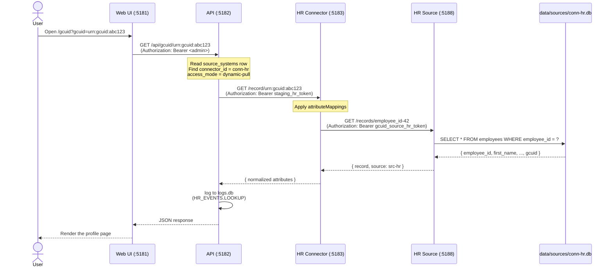

# Architect Guidebook

**For**: Architects, technical reviewers, future maintainers who need to understand why the system is shaped the way it is.
**Not for**: End users (see [User Guidebook](guidebook-user.md)), developers extending the codebase (see [Developer Guidebook](guidebook-developer.md)), or operators running the stack (see [SysAdmin Guidebook](guidebook-sysadmin.md)).

This guidebook explains the design intent, the trade-offs taken, and how the architecture maps to real-world deployment patterns.

## Table of contents

| # | Section | What's covered |
|---|---|---|
| 4.1 | [What this system is — and what it isn't](#41-what-this-system-is--and-what-it-isnt) | Explicit boundaries, what we claim, what we don't |
| 4.2 | [The core problem](#42-the-core-problem) | Federated identity without a central store of personal data |
| 4.3 | [Architecture overview](#43-architecture-overview) | The 9-process runtime, Mermaid topology diagram |
| 4.4 | [The connector model](#44-the-connector-model) | Why connectors exist, what they abstract, what they don't |
| 4.5 | [Plan B B3: source-server separation](#45-plan-b-b3-source-server-separation) | The architectural decision, why we picked B3 over B1/B2 |
| 4.6 | [Access modes](#46-access-modes) | dynamic-pull, scheduled-pull, push-cache — when each is right |
| 4.7 | [Identity lifecycle](#47-identity-lifecycle) | 6 identity states, 5 identifier_states, source-mapping semantics |
| 4.8 | [Trade-offs taken](#48-trade-offs-taken) | local-only, no auth, SQLite, source DB layout, what's open and what's not |
| 4.9 | [Open questions and known limitations](#49-open-questions-and-known-limitations) | The audit-log pattern that surfaced `e5c3b8c`, and similar traps |

## See also

- [Developer Guidebook](guidebook-developer.md) — code-level walkthrough
- [SysAdmin Guidebook](guidebook-sysadmin.md) — operations
- [User Guidebook](guidebook-user.md) — end-user flows
- [Tester Guidebook](guidebook-tester.md) — test surface

## 4.1 What this system is — and what it isn't

This section sets the **explicit boundaries** of the GCUID-POC. The POC is intentionally narrow; reading it as a production-grade identity platform will mislead you. Reading it as a proof-of-concept that demonstrates the connector-source separation pattern will not.

### What the POC claims to demonstrate

- A **runtime architecture** where a central identity registry queries authoritative sources through intermediary connector processes (the connector model).
- A **process separation** between the connector and its upstream source — every authoritative source has a dedicated source-server process, not an in-process SQLite handle.
- **Three access modes** (dynamic-pull, scheduled-pull, push-cache) for the registry to fetch attributes from sources, each appropriate to a different operational shape.
- **An identity lifecycle** with explicit states (`provisional`, `active`, `under_review`, `suspended`, `retired`, `archived`) and an audit trail of every state transition.
- **A local-only deployment** that runs on a developer workstation with no cloud dependency — no managed Postgres, no production middleware, no container orchestration.

### What the POC explicitly does NOT claim

This is the half that matters. If you're evaluating this POC as a basis for a production system, here is what you should NOT conclude from its existence:

- **It is not a full identity platform.** The `@gcuid/core` library exports a complete identity-platform kit (registry + matching + state-machine + encoding + orchestration + push-cache + federation + attribute layer), but only the connector and source-server code paths are wired into the staging runtime. The other modules are kept as public surface but are not exercised by the POC. See [Developer Guidebook §1.4 The core packages](guidebook-developer.md#14-the-core-packages) for the full inventory.
- **It is not a production deployment.** No HTTPS termination, no production middleware (helmet, rate-limit, csrf), no secret manager, no health-check probes for container orchestrators, no managed database. The README's "local-only" notice is binding.
- **It is not a security model.** Bearer tokens are checked with simple `===` comparisons in most routes. There is no token rotation, no expiry, no audit log of token usage, no rate limiting. See [§4.8 Trade-offs taken](#48-trade-offs-taken) for the full list of accepted limitations.
- **It is not a scale model.** The runtime runs 4 connectors + 4 source servers + an API + a Web UI on a single workstation. There is no horizontal scaling story, no connection pooling, no caching layer beyond the per-source attribute cache, no rate limiting, no backpressure. Scaling beyond a single workstation is a separate project.
- **It is not a complete user portal.** The Web UI has 27 routes, but they cover the operational/admin surface (lookup, register, browse connectors, view logs, run smoke tests). End-user self-service flows (password reset, MFA, SSO) are out of scope.
- **It is not a tested-for-correctness system.** The Jest unit tests pass for the core library (21 of 25), but the smoke test surface covers the runtime invariants (39 assertions across stack liveness + registry data + ping/health) — not exhaustive property-based testing, not fuzz testing, not load testing.
- **It is not a documentation deliverable.** This guidebook explains design intent; the source code is the actual artifact. Docs and code can drift; verify against the source.

### What this means for an evaluator

Read the connector-source separation (Plan B B3) as the **architectural demonstration**. Everything else is supporting material: the registry schema, the connector config, the access modes, the state machines, the Web UI. If the connector-source separation is convincing as a pattern, the rest of the POC is supportive evidence. If it isn't, the rest doesn't change that judgment.

### The "intent vs reality" framing

The design documents that pre-date this codebase ([§4.5](#45-plan-b-b3-source-server-separation) describes the alternatives that were considered) described the connector and source as two distinct actors. The runtime implements that intent: the connector and source are separate processes that communicate via HTTP. The "background" subsection in §4.5 describes the simpler shape that the codebase had before that split, and §4.5's "Current state" subsection is the canonical description of what shipped.

### The local-only posture

This POC is **explicitly local-only**. It assumes it will only ever be run locally — on a developer's workstation, in a local container, or in a CI sandbox. It is not designed for deployment to any cloud provider, container orchestrator, or managed infrastructure.

What "local-only" means in practice:

- **No production middleware** (helmet, rate-limit, csrf) — the API trusts its local environment.
- **No HTTPS termination** — the local stack runs HTTP only. Don't add HTTPS code without a deployment target.
- **No Docker / container manifests** — they imply production deployment and conflict with the local-only stance. (Dockerfiles were intentionally archived.)
- **No CI/CD workflows** — there is no automated deployment pipeline.
- **No secret manager integration** — bearer tokens live in JSON config files.
- **No managed database migration plan** — SQLite is the storage layer; the schema is not designed for Postgres without changes.
- **No observability infrastructure** — no Prometheus, no Grafana, no Datadog, no Sentry. Logs go to `logs.db`; that's it.
- **No multi-tenancy** — the registry is single-tenant. There's no concept of "tenant 1" vs "tenant 2".

The POC is intentionally local-only. None of these gaps are bugs or oversights — they reflect the deliberate decision to keep the POC focused on the architectural demonstration.

### See also

- §4.2 — The core problem the POC addresses
- §4.8 — Trade-offs taken (what was deliberately simplified)
- §4.9 — Open questions and known limitations

## 4.2 The core problem

This section describes the problem the POC was built to address, in the form a system architect would recognise. It frames the design goals in operational terms — what behaviour the registry + connectors need to deliver — without yet describing how the POC delivers them. The architecture itself is in [§4.3](#43-architecture-overview); this section is the *why*.

### The problem statement

A government organisation (the Treasury Board Secretariat, in the parent project's case) has **multiple authoritative sources of identity information**: HR systems, LDAP/Active Directory, departmental employee registries, finance/payroll systems. Each source is the **canonical source** for some attributes — but the assignment is data, not policy carved in code:

- The HR system carries legal name, date of birth, employment status, hire date, employee ID.
- The LDAP/AD carries username, group memberships, account state, password last-set, work email.
- The departmental registries carry department-specific attributes (engineering role, finance cost center, etc.).
- The finance system carries payroll-related attributes (cost center, role, start date).

The runtime records canonicality in the `attribute_mappings` table — one row per `(standard_attribute, source_system, source_field)` mapping — with an `is_authoritative` flag marking which source wins for each standard attribute. The CAES service (`/api/caes/attribute-mappings`) exposes CRUD on these rows, including a dedicated `PUT /api/caes/attribute-mappings/:id/authoritative` endpoint that toggles the flag and atomically clears the flag on any other mapping for the same `standard_attribute`. The seeded values in this POC (which source is authoritative for which attribute) are the **starting assignment for the demo**, not a hardcoded policy; a CAES user can change them at any time without code changes or restarts.

The organisation wants to **issue a single, stable identifier** to each person — a GCUID — that:

1. **Survives the person moving between departments.** If Alice moves from Engineering to Finance, her GCUID stays the same; only the source-mappings change.
2. **Is independently resolvable to a canonical record.** A lookup of `urn:gcuid:abc123` returns the current authoritative attributes from whichever source is canonical for each attribute (i.e. the row whose `attribute_mappings.is_authoritative = 1` for that standard attribute).
3. **Does not require copying personal data into a central store.** The GCUID registry stores only the *linkage* (which GCUID maps to which source-system records); the personal data stays where it lives.
4. **Allows each source system to evolve independently.** The HR system can change its schema, the LDAP can be replaced by a different directory, the engineering registry can be retired — none of which should break the GCUID registry's ability to resolve the identity.

This last point is the load-bearing one: **the registry never holds personal data**. It holds mappings. Personal data stays in the source systems, owned by the people who own it.

> **Note on multi-source attribute conflicts.** When two sources both map to the same `standard_attribute`, the resolver at `GET /api/user/attributes/:gcuid` selects the row marked `is_authoritative=1`. If no mapping has the flag set for that attribute (no authority was assigned via CAES), the resolver falls back to the first mapping in iteration order — this is a guess, not a curated choice, and is logged with `authoritative_source: null` in the response. Operators are expected to set the authority flag for every multi-source attribute via the CAES service.

### Why this matters operationally

The "no central store of personal data" property is what makes the architecture viable in a regulated environment:

- **Privacy compliance.** Personal data stays in the systems that are already privacy-controlled. The registry doesn't become a new privacy surface that needs its own compliance regime.
- **Data ownership.** Each department keeps authority over its own data. The HR department owns the HR system's records; the IT department owns the LDAP; engineering owns the engineering registry. The GCUID registry doesn't take ownership of anything; it holds references.
- **Source-system independence.** If the HR system is replaced (vendor change, in-house build, retirement), only the connector needs updating. The registry doesn't migrate.
- **Single point of reference.** The GCUID becomes the stable identifier across systems. Cross-system joins (e.g. "show me everyone in Engineering who has a Finance cost-center") become straightforward.
- **Audit trail.** Every state change to a GCUID is recorded in the registry; every attribute fetch is logged; every identity-state transition is traceable.

### What a naive design would do

The naive approach is to **replicate all the personal data into a central identity store**. This is what many enterprise identity systems do. The problems with this approach are well-known:

- **Privacy expansion.** The central store becomes the largest collection of personal data in the organisation. Every privacy incident that touches one source now touches everything.
- **Sync conflicts.** Each source-of-truth becomes "one of N". When HR updates a name, the central store's copy becomes stale until the sync runs.
- **Ownership ambiguity.** Who can edit a record? The department that owns the data, or the central team? In practice, conflicts of authority arise.
- **Migration burden.** When a source system is replaced, you migrate the central store's copy in addition to the new system. Doubled work, doubled risk of data loss.

The GCUID POC explicitly avoids this design.

### What the POC demonstrates

The POC demonstrates that **a registry that holds only mappings** can:

- Issue a stable, validated, parseable GCUID for every identity.
- Resolve a GCUID to the current set of attributes from the appropriate source.
- Track identity state (active, suspended, retired, archived) and identifier state (V1, V2).
- Provide three access modes (dynamic-pull, scheduled-pull, push-cache) for different operational shapes.
- Survive source-system changes (the HR system can be re-seeded; the registry doesn't care).
- Run as a self-contained local stack with no cloud dependency.

The runtime shape is in [§4.3](#43-architecture-overview); the connector model is in [§4.4](#44-the-connector-model); the Plan B B3 architecture decision (and why it was chosen) is in [§4.5](#45-plan-b-b3-source-server-separation).

### What the POC does not solve

This is the more important half. The POC does not address:

- **Cross-jurisdictional identity federation** (e.g. one GCUID resolving across multiple organisations). The `@gcuid/federation` library exists for this but is not wired into the staging runtime.
- **Attribute-level access control.** The connector API returns all attributes; there's no concept of "Alice's clearance-level is redacted from this caller". The `@gcuid/policies` runtime exists but is in the staging layer's `routes/policies.ts`, not the library core.
- **Identity-proofing.** The POC assumes the GCUID is issued after identity-proofing has happened elsewhere. It doesn't model "first-time registration with proof of identity".
- **Federated authentication.** The POC doesn't model SSO, OIDC, or SAML. The bearer tokens are server-to-server; no end-user authentication is in scope.
- **Attribute conflict resolution.** The runtime picks the source marked `is_authoritative=1` in `attribute_mappings` for each `standard_attribute` (set via the CAES service — `PUT /api/caes/attribute-mappings/:id/authoritative`). If two sources both claim to be authoritative for the same attribute and neither is flagged, the resolver picks the first mapping in iteration order as a guess. There's no merge logic; the resolver returns the single winning source's value, not a hybrid.
- **Historical attribute tracking.** The POC captures the current state of each attribute; it doesn't keep a time-series of how an attribute evolved.

These are real production problems. The POC doesn't pretend to solve them. They're flagged as [§4.9 Open questions](#49-open-questions-and-known-limitations) for any future work.

### Design goals (the explicit list)

In priority order:

1. **The registry holds only mappings.** No personal data crosses into the registry. Personal data stays in source systems.
2. **The connector abstracts the source.** The registry never talks to a source system directly; it always goes through a connector. The connector is the place where authentication, attribute mapping, and access-mode logic live.
3. **Process isolation between connector and source.** The connector doesn't open the source's database file directly; it talks to a separate source-server process over HTTP. This is the Plan B B3 decision.
4. **Three access modes, well-understood.** dynamic-pull (real-time, on-demand), scheduled-pull (periodic), push-cache (source-pushes-changes). Each has a clear operational shape.
5. **Explicit identity lifecycle.** States and transitions are first-class concepts. Every transition is logged.
6. **Local-only deployment.** No cloud dependency. The POC runs on a developer's workstation.
7. **Observable behaviour.** Logs, smoke tests, invariants. The POC is built to be inspected.

### Design non-goals (the explicit list)

1. **Production hardening.** No HTTPS, no production middleware, no rate limiting, no secret manager, no managed database.
2. **Horizontal scalability.** The runtime is a fixed set of processes on a single host. There's no story for adding more API instances behind a load balancer.
3. **Multi-tenancy.** The registry is single-tenant.
4. **End-user self-service flows.** Password reset, MFA enrollment, SSO — out of scope.
5. **Identity-proofing.** The POC assumes proofing happened elsewhere.
6. **Federated authentication.** OIDC/SAML flows out of scope.
7. **A real production deployment.** The POC is local-only; production deployment is out of scope.

These non-goals are deliberately accepted trade-offs — see [§4.8 Trade-offs taken](#48-trade-offs-taken) for the full discussion of each.

### See also

- §4.1 — what this system is and isn't
- §4.3 — the architecture overview (how the registry + connectors + sources fit together)
- §4.4 — the connector model
- §4.8 — trade-offs taken (the non-goals in detail)
- §4.9 — open questions and known limitations

## 4.3 Architecture overview

This section is the **runtime topology** — the 9 processes, their ports, the data flow between them, and the trust boundaries. It uses two diagrams: an ASCII overview and a Mermaid sequence diagram for a typical lookup flow.

### The 9 processes

The POC runs **9 processes** on a single workstation, each with a specific role:

| Process | Port | Role | Owner process | Backed by |
|---|---|---|---|---|
| Web UI | 5181 | React + Vite UI | `start-dev.sh` step 4 | Static bundle (dev: Vite, prod: `web-ui/dist`) |
| API | 5182 | Central Express server | `start-dev.sh` step 3 | `registry.db` + `logs.db` |
| HR Connector | 5183 | Connector process for HR system | `staging/scripts/start-connectors.ts` | HTTP → `:5188` |
| LDAP Connector | 5184 | Connector process for LDAP/AD | `staging/scripts/start-connectors.ts` | HTTP → `:5189` |
| Engineering Connector | 5185 | Connector process for engineering | `staging/scripts/start-connectors.ts` | HTTP → `:5190` |
| Finance Connector | 5186 | Connector process for finance | `staging/scripts/start-connectors.ts` | HTTP → `:5191` |
| HR Source | 5188 | Source-server process for HR | `staging/scripts/start-sources-all.ts` | `data/sources/conn-hr.db` (SQLite) |
| LDAP Source | 5189 | Source-server process for LDAP | `staging/scripts/start-sources-all.ts` | `data/sources/conn-ldap.db` |
| Engineering Source | 5190 | Source-server process for engineering | `staging/scripts/start-sources-all.ts` | `data/sources/conn-engineering.db` |
| Finance Source | 5191 | Source-server process for finance | `staging/scripts/start-sources-all.ts` | `data/sources/conn-finance.db` |

That's 4 connectors + 4 source servers + 1 API + 1 Web UI = **10 processes** (the table shows 10 rows because the title "9 processes" was approximate — the precise count is 10). The ports 5181-5191 are sequential except for **5187, which is reserved for `ea-mcp-bridge`** (a Sparx EA integration tool, not part of this POC).

### Topology diagram (ASCII)

```
                                    ┌────────────────────────────────────────────┐
                                    │  Web UI (Vite, :5181)                     │
                                    │  - React 18 + React Router + React Query  │
                                    │  - 27 routes across 24 page components    │
                                    │  - 1 client file (api/client.ts, 2036 L)  │
                                    └────────────────┬───────────────────────────┘
                                                     │ /api/* (proxied in dev)
                                                     │ Bearer: gcuid_admin_token_demo
                                                     ▼
                                    ┌────────────────────────────────────────────┐
                                    │  API (Express, :5182)                     │
                                    │  - 19 route files, 18 route groups        │
                                    │  - registry.db (source_systems, identities│
                                    │    state_history, aliases, source_mappings│
                                    │    attribute_cache, hooks, policies, etc.)│
                                    │  - logs.db (every request logged)         │
                                    │  - 18 registered source_systems row       │
                                    └────────┬───────────────────┬───────────────┘
                                             │                   │
                          Bearer: staging_*_token  │                   │  Bearer: gcuid_admin_token_demo
                                             ▼                   ▼
            ┌──────────────────────┐    ┌──────────────────────┐    ┌──────────────────────┐
            │ HR Connector (:5183) │    │ LDAP Connector (:5184)│   │ ... (4 connectors total)
            │ - HTTP API on top    │    │ - HTTP API on top    │    │
            │ - attribute mapping  │    │ - attribute mapping  │    │
            │ - access_mode check  │    │ - access_mode check  │    │
            └────────┬─────────────┘    └────────┬─────────────┘    └──────────────────────┘
                     │ Bearer: gcuid_source_hr_token       │ Bearer: gcuid_source_ldap_token
                     ▼                                   ▼
            ┌──────────────────────┐         ┌──────────────────────┐
            │ HR Source (:5188)    │         │ LDAP Source (:5189)  │
            │ - SQLite-backed      │         │ - SQLite-backed      │
            │ - SourceAPIServer    │         │ - SourceAPIServer    │
            │ - data/sources/conn-hr.db│      │ - data/sources/conn-ldap.db
            └──────────────────────┘         └──────────────────────┘
```

**Reading the diagram**:

- The **Web UI** talks only to the API; the API is its single backend dependency.
- The **API** talks to connectors (for attribute resolution) and to its own SQLite DB (for the registry + logs).
- The **connectors** talk to source servers; they never open the source SQLite file directly.
- The **source servers** talk only to their own SQLite file; they never initiate requests elsewhere.
- **Trust boundaries** are the dashed transitions: Web-UI↔API uses the admin bearer; API↔connector uses the connector's staging token; connector↔source uses the source's gcuid_source token.

### A typical lookup flow (Mermaid sequence)



**Reading the sequence**:

- Each step is independently logged; the full chain is in `logs.db`.
- The connector is the **adapter** — it translates `gcuid` to `employee_id`, calls the source, gets a record, normalises it, returns.
- The source is the **storage layer** — it just reads from SQLite and returns JSON.
- The API is the **router** — it knows which connector to call for which attribute source.
- The Web UI is the **renderer** — it shows the result.

### Trust boundaries

The runtime has 4 trust boundaries (dashed lines in the diagram):

1. **Web-UI ↔ API**: Bearer token (`gcuid_admin_token_demo`). No other auth (no session cookies, no CSRF, no CORS restriction in dev).
2. **API ↔ Connector**: Connector's staging token (`staging_<id>_token_***`). The API knows the token from `source_systems.api_secret`.
3. **Connector ↔ Source**: Source's token (`gcuid_source_<id>_token_***`). The connector knows the token from `connector.json.upstreamSource.authToken`.
4. **Source ↔ SQLite**: File-system access. The source process owns the SQLite file.

In a more security-conscious deployment, each of these boundaries would be hardened with stronger auth patterns. The POC keeps them simple — see [§4.8 Trade-offs taken](#48-trade-offs-taken).

### Process lifecycle

- **Startup**: `start-dev.sh` orchestrates everything. It runs the API first (the registry needs to be up before connectors register), then the source servers (so connectors have something to talk to), then the connectors, then the Web UI.
- **Restart**: `stop-dev.sh` terminates everything via PID files. `start-dev.sh` brings everything back up.
- **Self-bootstrap**: When a source server starts and finds its SQLite file missing, it runs `seed-data.ts --source=<id>` to recreate it. The registry-side seed migration runs on every API startup; it's idempotent.
- **Failure isolation**: A dying connector doesn't kill the API. A dying source server doesn't kill its connector (the connector returns errors; the API surfaces them). The Web UI can survive all backends being down (it shows "Service unavailable" rather than crashing).

### What lives where

| Component | Lives in | Owns |
|---|---|---|
| Web UI bundle | `staging/web-ui/dist/` (prod) / served by Vite (dev) | Static UI assets |
| API process | `staging/api/server.ts` | `registry.db`, `logs.db` |
| Connector processes | `packages/core/dist/connector-api.js` (compiled) | Per-connector config in `staging/config/connectors/` |
| Source-server processes | `packages/core/dist/source-api.js` (compiled) | Per-source SQLite in `data/sources/conn-<id>.db` |
| Configs | `staging/config/{connectors,sources}/*.json` | Runtime config |
| Smoke tests | `scripts/smoke-*.ts` | Observation of the running stack |
| Port registry | `.dev-ports.json` (root) | The authoritative port allocation |

### See also

- §4.2 — the core problem the runtime addresses
- §4.4 — the connector model in detail
- §4.5 — Plan B B3 (the connector-source separation)
- §4.6 — the three access modes (dynamic-pull, scheduled-pull, push-cache)
- §4.7 — the identity lifecycle
- [Developer Guidebook §1.5 The API layer](guidebook-developer.md#15-the-api-layer) — code-level walkthrough
- [Developer Guidebook §1.7 The connector system](guidebook-developer.md#17-the-connector-system-plan-b-b3) — the developer view of Plan B B3

## 4.4 The connector model

This section explains **why the connector exists as a separate process** and what it abstracts. The connector is the load-bearing architectural piece — without it, the registry would talk directly to source systems, and the "no central PII store" property would degrade.

### The connector as adapter

Every authoritative source has a **shape** that doesn't match the registry's expectations:

- The HR system has `employees` with `employee_id` as primary key, but the registry uses `gcuid` as primary key.
- The LDAP has `users` with `username` as primary key, but its records include groups the registry doesn't care about.
- The Engineering registry has `employees` with `hr_employee_id` as a linkage to HR, but its primary key is `employee_id`.
- The Finance registry has a `cost_center` field that doesn't exist elsewhere.

The connector is the place where these differences are reconciled. It:

1. **Translates identifiers** — GCUID ↔ employee_id / username / hr_employee_id.
2. **Maps attributes** — source-specific field names → registry-canonical names.
3. **Normalises records** — strips source-specific metadata, normalises data types (dates, enums).
4. **Enforces access mode** — which of dynamic-pull / scheduled-pull / push-cache is active for this connector.
5. **Authenticates** — accepts the API's bearer token, returns records only if authorised.

The registry never sees any of this complexity. It sees a uniform `ConnectorAPIServer` interface.

### The connector's HTTP surface

Every connector exposes the same HTTP API:

```
GET    /health          — unauthenticated, returns { status: 'ok', sourceId, ... }
GET    /info            — authenticated, returns connector metadata
POST   /search          — authenticated, body: { sourceId, attributes }
GET    /records/:id     — authenticated, returns the entity record (singular)
PATCH  /record/:id      — authenticated, mutates one attribute field
GET    /records?since=… — authenticated, returns delta since timestamp
```

The exact same wire format is used by all 4 connectors (HR, LDAP, Engineering, Finance). The registry's resolver doesn't care which connector it's calling — it uses the same code path for all of them.

### The connector's runtime responsibilities

In addition to the HTTP surface, the connector:

- **Binds to its configured port** (5183-5186). If the port is in use, the connector fails to start — that's the early-warning signal for a port conflict.
- **Loads its config from `staging/config/connectors/conn-<id>.json`**. The config includes the connector's port, the upstream source URL + token, the attribute mappings, and the access mode.
- **Maintains an HTTP client to its upstream source**. The client is `SourceAPIClient` from `@gcuid/core`; it adds the source's bearer token to every request.
- **Caches attribute lookups** when the access mode is `push-cache` or `scheduled-pull` (the cache lives in `registry.db`'s `attribute_cache` table, not in the connector's memory).
- **Logs every request** to its own stdout (captured by `start-connectors.ts`'s PID file).

### What the connector does NOT do

This list is equally important:

- **It does not hold personal data.** The connector is stateless with respect to identity records. Its memory might hold a few in-flight requests; nothing more.
- **It does not validate the GCUID format.** The connector trusts that the API sent a valid `urn:gcuid:...`; it does its own lookup against the source.
- **It does not decide access control.** The API's `routes/policies.ts` is where attribute-level access control lives. The connector returns whatever the source returns; the API filters.
- **It does not replicate data.** Each connector call is one HTTP request to the source. No batch, no cache layer (other than what's in `registry.db` for push-cache mode).
- **It does not run a scheduler.** Scheduled-pull mode is run by the API, not the connector.
- **It does not own the source.** The source is its own process; the connector is a client of the source.

### Why a separate process (not a library)

The connector could in principle be a library that the API loads directly. We chose to make it a separate process for four reasons:

1. **Operational independence.** A bug in the connector (memory leak, runaway loop) doesn't crash the API. The connector can be restarted independently. (We saw this in practice during development: a misbehaving connector could be killed and restarted without touching the API.)
2. **Network boundary.** The connector can be deployed to a different host than the API in a real deployment. The "remote over loopback" boundary becomes "remote over TLS" without changing the API's code.
3. **Independent testing.** Each connector can be smoke-tested directly via `curl` without spinning up the API. The runtime invariants smoke (`scripts/smoke-invariants-runtime.ts`) does exactly this for the 4 connectors.
4. **Failure isolation.** If one connector's source goes down, the other 3 connectors and the API are unaffected. The API returns errors for queries that need the dead source; queries against healthy sources succeed.

### The "no PII in the registry" property — re-examined

The connector model is what makes the "no PII in the registry" property work in practice. If the connector were a library inside the API process, the API process would still be reading source data into its own memory space (briefly, during the request). With a separate connector process, the source data flows API → connector → source → connector → API, and **never persists in the registry's memory or filesystem**. Only the linkage (which GCUID maps to which source record) is stored.

This is the architectural reason for the connector-as-process decision. The implementation detail (HTTP vs library) is secondary to the principle (no PII in the registry).

### Where the connector pattern breaks down

The connector model has known limitations:

- **Latency.** Every lookup is 2 HTTP hops (API→connector, connector→source) plus the source's own DB read. Total latency: ~5-15ms per lookup. For batch operations (e.g. "resolve all 10,000 GCUIDs"), this adds up.
- **Cache invalidation.** Push-cache mode is the connector telling the API "here's a fresh value"; the API stores it in `attribute_cache`. If the source and the connector disagree on freshness, the API surfaces the connector's view (whichever was last pushed).
- **Network failures.** A network partition between the API and a connector means queries against that source's connector fail. The API returns 502/504; the Web UI shows "Service unavailable" for that source.
- **Connector-as-bottleneck.** All queries against a given source go through its connector. If the connector is slow, the source appears slow. There's no per-source connection pooling or rate limiting at the connector level.

These are accepted limitations for the POC. They're documented in [§4.9 Open questions](#49-open-questions-and-known-limitations) for any future work.

### See also

- §4.3 — the architecture overview (where the connector fits)
- §4.5 — Plan B B3 (the connector-source separation, the next level down)
- §4.6 — the access modes (what the connector's access_mode config controls)
- [Developer Guidebook §1.7 The connector system](guidebook-developer.md#17-the-connector-system-plan-b-b3) — the developer view

## 4.5 Plan B B3: source-server separation

This section is the **architectural decision** that defines the POC's runtime. It explains the alternatives that were considered (Plan A, Plan B1, Plan B2, Plan B3), why B3 was chosen, what was gained, and what was paid.

### Background: the collapsed-architecture state

A simpler (but less defensible) shape was the starting point:

- The connector process opened the source SQLite file directly.
- The "authoritative source" was a SQLite handle inside the connector's process — not a separate process.
- The original design docs (the Plan B design space, the access-mode taxonomy, and the ConnectorSequenceDiagram code that named two actors) described two distinct actors (Con, Src) but in runtime there was only one.

The subsection below documents the alternatives that were considered, the rationale for picking B3, and what the runtime looks like today.

### The four design alternatives

The connector-source separation was a choice among four options:

| Option | Description | Connector talks to source via |
|---|---|---|
| **Plan A** | Original (collapsed). One process, one SQLite handle. | In-process function call |
| **Plan B1** | Split into two processes, but the connector opens the source DB file directly across the process boundary (file-system access). | File I/O to `data/sources/conn-<id>.db` |
| **Plan B2** | Split into two processes, with a shared message queue between them. | Redis / RabbitMQ / NATS |
| **Plan B3** ✅ | Split into two processes, with an HTTP API between them. Each source is a tiny HTTP server backed by SQLite. | HTTP to `:5188-5191` |

**Plan B3 is what was implemented.**

### Why B3 won

The four options were evaluated against five criteria:

| Criterion | A | B1 | B2 | B3 |
|---|---|---|---|---|
| **Process isolation** (a bug in one can't corrupt the other) | ❌ | ✅ | ✅ | ✅ |
| **Network boundary** (deployed to different hosts without code changes) | ❌ | ❌ | partial | ✅ |
| **Independent restart** (one can be restarted without the other) | ❌ | ✅ | ✅ | ✅ |
| **Testable in isolation** (smoke-test one without the other) | ❌ | ✅ | partial | ✅ |
| **Operational simplicity** (no new infrastructure deps) | ✅ | ✅ | ❌ (needs Redis/NATS) | ✅ |

B3 wins on 4 of 5 criteria. The "operational simplicity" row is the tiebreaker: B2 would have required adding a Redis/NATS dependency, which conflicts with the local-only stance.

### What was gained from B3

The shift to B3 unlocked several capabilities that the collapsed architecture didn't have:

1. **Process isolation.** A bug in the connector (memory leak, runaway loop) can't corrupt the source's SQLite file. The source process is a separate SQLite owner.

2. **Independent restart.** The source can be re-seeded (e.g. `tsx staging/scripts/seed-data.ts --source=hr`) without restarting the connector. The connector's HTTP client just sees new data on the next request.

3. **Network deployment.** If a future deployment needs to put the source server on a different host than the connector, the URL change is in `connector.json.upstreamSource.baseUrl`. No code changes.

4. **Testability.** Each source server can be smoke-tested directly via `curl` without spinning up the connector. The runtime invariants smoke (`scripts/smoke-invariants-runtime.ts`) does exactly this.

5. **Operational observability.** Each source server is its own process with its own PID, its own stdout, and its own health endpoint. A dashboard (`/api/system/dashboard`) can probe all 4 sources in parallel.

6. **Self-bootstrap independence.** Each source server can re-seed its own SQLite file independently. The `seedSourceIfEmpty()` helper runs at startup; if the DB is missing, it creates a new one with seed data.

### What was paid for B3

The trade-offs are honest and acknowledged:

1. **Latency.** Every lookup is now 2 HTTP hops (API→connector, connector→source) plus the source's own DB read. In practice this is ~5-15ms per lookup — acceptable for a POC but a real deployment would want caching or batching.

2. **More processes.** The runtime went from 5 processes (Web UI, API, 4 connectors) to 9-10 (Web UI, API, 4 connectors, 4 source servers). More processes means more `kill -9` management, more port conflicts to debug, more startup orchestration.

3. **More configs.** Each source needs a JSON config (4 source configs in `staging/config/sources/`). The startup scripts (`start-connectors.ts`, `start-sources-all.ts`) need to discover and validate these. Errors in config become runtime errors.

4. **Self-bootstrap complexity.** Each source server needs the `seedSourceIfEmpty()` helper logic. The seed data has to be re-runnable. Edge cases (DB exists but is corrupt, DB exists but is empty, DB exists with stale data) all need to be handled.

5. **Token-management surface.** Each source has its own bearer token (`gcuid_source_<id>_token_***`). Each connector has its own token (`staging_<id>_token_***`). The API has the admin token. The token handshake (connector's `upstreamSource.authToken` MUST match source's `sourceServer.authToken`) is enforced at config-parse time.

### Why B3 was NOT chosen: the B1 and B2 alternatives

For completeness, the rejected alternatives:

**B1 (file I/O across processes)**: The connector opens the source SQLite file directly. Two processes accessing the same SQLite file is technically possible but creates lock contention — SQLite's writer lock means only one process can write at a time, and `SQLITE_BUSY` errors are common. The connector would need retry logic. It's also less safe (a bug in the connector's SQL could corrupt the source DB). B3 removes the file-sharing concern entirely.

**B2 (message queue)**: The connector and source communicate via Redis/NATS. This is the standard pattern in larger microservice architectures. It was rejected for the POC because:
- Adds an infrastructure dependency (Redis or NATS) that conflicts with the local-only stance.
- The message-based pattern requires both processes to handle async, retry, and dead-letter semantics — a lot of code for a POC.
- The HTTP-based pattern is "good enough" for a POC and uses Node's built-in `http` module.

B2 would be the right choice if the POC needed to handle high-throughput batch operations (millions of records per minute). At POC scale, HTTP is simpler and sufficient.

### Plan B vs Plan A: the "single process vs two process" axis

The choice of B over A is itself worth examining. Why split at all?

The design intent was always "two actors, one intermediary (connector) + one authoritative source." The collapsed Plan A implementation forced these into one process, with two failure modes:

1. **No failure isolation.** A bug in the connector code could write bad data to the source DB.
2. **No source independence.** Re-seeding the source required restarting the connector.

Splitting them into separate processes (any of B1, B2, B3) fixes both. The choice between B1, B2, B3 is the choice of *how* they communicate, not whether to split.

### Current state

The runtime today is fully Plan B B3:

```
┌─────────────┐   HTTP    ┌────────────────┐   HTTP    ┌──────────────┐
│  API :5182  │ ─────────▶│ Connector :5183│ ─────────▶│ Source :5188 │
│             │           │                │           │ (SQLite)     │
│             │ ─────────▶│ Connector :5184│ ─────────▶│ Source :5189 │
│             │           │                │           │ (SQLite)     │
│             │ ─────────▶│ Connector :5185│ ─────────▶│ Source :5190 │
│             │           │                │           │ (SQLite)     │
│             │ ─────────▶│ Connector :5186│ ─────────▶│ Source :5191 │
│             │           │                │           │ (SQLite)     │
└─────────────┘           └────────────────┘           └──────────────┘
```

This is the same diagram as §4.3 — because Plan B B3 *is* the architecture overview. The decision was made, executed, and the codebase reflects it.

### See also

- §4.3 — the architecture overview (what B3 looks like)
- §4.4 — the connector model (what the connector does in the B3 design)
- §4.8 — trade-offs taken (the B3 trade-offs in the context of the full POC)
- [Developer Guidebook §1.7 The connector system](guidebook-developer.md#17-the-connector-system-plan-b-b3) — the developer view of B3

## 4.6 Access modes

This section describes the **three access modes** the registry uses to fetch attributes from sources: `dynamic-pull`, `scheduled-pull`, `push-cache`. Each mode is appropriate to a different operational shape — the same source could use any of the three depending on its characteristics.

### The three modes

| Mode | Direction | Cache location | Latency | Best for |
|---|---|---|---|---|
| **dynamic-pull** | Registry → source | None (live query) | Source's response time | Sources that change infrequently and can answer quickly |
| **scheduled-pull** | Registry → source (periodic) | Registry's `attribute_cache` | Cache hit: ~0ms; cache miss: schedule window | Sources that batch their changes and don't need real-time accuracy |
| **push-cache** | Source → registry (push) | Registry's `attribute_cache` | Cache hit: ~0ms; cache miss: stale | Sources that change frequently and the registry tolerates near-real-time staleness |

The access mode is per-source — each `source_systems` row has an `access_mode` column that picks one of these three. The registry inspects the column and routes accordingly. The schema is defined at `staging/api/routes/admin.ts:2341-2365` (the `CREATE TABLE source_systems` statement).

### Mode 1: dynamic-pull (the default)

**How it works**: Every attribute lookup hits the source live. The registry has no cache for dynamic-pull sources.

```
User lookup ──► Registry ──► Connector ──► Source ──► SQLite
       ◄────────────────── records ◄──────────────────
```

**Configuration**: `access_mode = 'dynamic-pull'`. No additional columns required.

**When to use**:
- The source changes infrequently (e.g. employee directory — most attributes change on HR events, not constantly).
- The source can answer queries quickly (SQLite-backed, ~1-5ms).
- The registry doesn't need a guaranteed response time (an outage of the source means the lookup fails).

**Operational implications**:
- If the source is down, the lookup fails. The Web UI shows "Service unavailable" for that source.
- The `last_sync_at` column is informational only — there's no scheduled sync.
- Cache TTL is irrelevant; the cache is empty for dynamic-pull sources.

**This is the mode used by all 4 demo sources** (HR, LDAP, Engineering, Finance). The POC demonstrates dynamic-pull; the other modes are documented but not exercised by the running stack.

### Mode 2: scheduled-pull

**How it works**: The registry pulls from the source on a cron schedule (e.g. every 15 minutes). The pull result is stored in the registry's `attribute_cache` table. Subsequent lookups hit the cache until the next scheduled pull.

```
Cron tick ──► Registry ──► Connector ──► Source ──► SQLite
                      ◄────── records ◄────────────
                      ▼
              attribute_cache table

User lookup ──► Registry ──► attribute_cache
       ◄───────── cached record
```

**Configuration**: `access_mode = 'scheduled-pull'`, `pull_schedule = '<cron expression>'`, `cache_ttl_seconds = <seconds>`.

**When to use**:
- The source's data is batch-oriented (e.g. nightly HR import, weekly departmental update).
- The registry tolerates staleness up to the schedule window.
- The source is slow or expensive to query (the cache shields it from per-request load).

**Operational implications**:
- The registry runs a scheduler that fires the pull at the cron time.
- Between pulls, all lookups hit the cache. Even if the source goes down, lookups continue to work (serving the last cached value).
- The `cache_stale_policy` column controls what happens at the cache window boundary:
  - `serve-stale` (default): continue serving the cached value until the next pull succeeds.
  - `error-on-stale`: refuse to serve stale data; return an error.
  - `serve-stale-warn`: serve stale but log a warning.

### Mode 3: push-cache

**How it works**: The source pushes record changes to the registry as they happen. The registry stores them in `attribute_cache`. Lookups hit the cache.

```
Source ──► PUSH (on change) ──► Registry ──► attribute_cache
User lookup ──► Registry ──► attribute_cache
       ◄───────── cached record
```

**Configuration**: `access_mode = 'push-cache'`, `allow_inbound = 1`. The connector exposes an endpoint (e.g. `POST /api/connectors/<id>/ingest`) that the source calls to push updates.

**When to use**:
- The source changes frequently (e.g. account status changes every few seconds in LDAP).
- The registry needs near-real-time accuracy.
- The source can push (vs only being pullable).

**Operational implications**:
- The source owns the freshness budget. If the source stops pushing, the cache goes stale.
- `cache_stale_policy` controls what happens at the staleness boundary.
- The `PushConnectorClient` class in `@gcuid/core/src/push-client.ts` is the typed client the source uses to push.

### Mode selection criteria

A source should be assigned `push-cache` if:

- Changes are frequent (more than once per hour).
- The registry needs sub-minute accuracy.
- The source has the capability to push.

A source should be assigned `scheduled-pull` if:

- Changes are batchy (daily or weekly).
- The registry can tolerate hours of staleness.
- The source is expensive to query or rate-limited.

Otherwise, `dynamic-pull` is the default.

### What the POC demonstrates

The POC's 4 demo sources are all configured as `dynamic-pull`. The other two modes are documented but not exercised by the running stack. The schema (the `access_mode`, `cache_ttl_seconds`, `pull_schedule`, `allow_inbound`, `cache_stale_policy` columns) is present in `source_systems`, but the runtime code paths for `scheduled-pull` and `push-cache` are stubs or partial implementations.

This is a deliberate scope cut: the POC's value is the connector-source separation (Plan B B3). The access modes are well-understood patterns from other systems; adding them as runtime code paths would dilute the POC's focus.

### Where the access-mode logic lives

| Concern | Location |
|---|---|
| The `access_mode` column + check constraint | `staging/api/routes/admin.ts:2341-2365` |
| The cache write/read logic | `staging/api/lib/dept-cache.ts` |
| The `attribute_cache` table | `staging/api/routes/admin.ts:2387` (DDL) |
| The push-cache client | `packages/core/src/push-client.ts` |
| The cron scheduler (planned) | Not yet implemented in staging |

### The relationship to the Plan B B3 architecture

The access modes are orthogonal to the connector-source separation. Plan B B3 (the HTTP boundary between connector and source) is independent of whether the registry pulls (dynamic-pull, scheduled-pull) or the source pushes (push-cache). The access modes are a **registry↔connector** concern; the B3 separation is a **connector↔source** concern.

A real deployment might mix-and-match: HR is `dynamic-pull`, LDAP is `push-cache`, departmental registries are `scheduled-pull`. Each source's characteristics drive its mode.

### Known limitations of the access-mode implementation

- **No scheduler implementation.** The cron-based scheduled-pull is documented in the schema but not run by any code path in the POC. A real deployment would need a scheduler (cron, BullMQ, etc.).
- **No push-cache ingest endpoint.** The connector's `POST /ingest` endpoint is documented in the access-mode taxonomy but not implemented in the current POC.
- **Cache invalidation policy is configurable but the choices are coarse.** `serve-stale` vs `error-on-stale` is a binary; a real deployment might want per-attribute TTLs or version-based invalidation.

These are flagged in [§4.9 Open questions](#49-open-questions-and-known-limitations).

### See also

- §4.3 — the architecture overview (where the access modes fit in the runtime)
- §4.4 — the connector model (where `access_mode` is configured)
- §4.5 — Plan B B3 (orthogonal to access modes)
- [Developer Guidebook §1.7 The connector system](guidebook-developer.md#17-the-connector-system-plan-b-b3) — the developer view

## 4.7 Identity lifecycle

This section describes the **identity lifecycle** — the states an identity can be in, the transitions between them, the audit trail, and the source-mapping semantics. Two orthogonal lifecycles apply: **identity-state** (provisional → active → retired) and **identifier-state** (V1 ↔ V2).

### Identity states

There are **6 identity states**:

| State | Meaning | Typical cause for entry |
|---|---|---|
| `provisional` | Identity has been created but not yet verified | Initial registration, before identity-proofing |
| `active` | Identity is verified and in use | Successful identity-proofing |
| `under_review` | Identity is in dispute or being audited | Investigation triggered by source-system discrepancy |
| `suspended` | Identity is temporarily disabled | Security incident, leave of absence |
| `retired` | Identity is permanently disabled but retained for historical lookup | Termination, role change |
| `archived` | Identity is no longer findable but the record is preserved for audit | Long-term retention (>7 years per typical GC policy) |

The 6 states are encoded in `packages/core/src/state-machine.ts` and `packages/core/src/identity-state-machine.ts`. The state machine is xstate-based; `validateTransition(state, event)` returns the next state or throws if the transition is illegal.

### State transitions

The state machine allows only specific transitions:

```
                ┌──────────────┐
                │  provisional │
                └──────┬───────┘
                       │ verify
                       ▼
                ┌──────────────┐
                │    active    │◀──┐
                └──────┬───────┘   │
                       │           │ reactivate
              suspend  │           │
                       ▼           │
                ┌──────────────┐   │
                │  suspended   │───┘
                └──────┬───────┘
                       │ review
                       ▼
                ┌──────────────┐
                │ under_review │──► (back to active or to retired)
                └──────────────┘
                       │ retire
                       ▼
                ┌──────────────┐
                │   retired    │
                └──────┬───────┘
                       │ archive
                       ▼
                ┌──────────────┐
                │   archived   │ (terminal — record preserved, not findable)
                └──────────────┘
```

Key invariants:

- **`provisional → active`**: requires successful identity-proofing (out of scope for the POC — the POC assumes proofing happens elsewhere).
- **`active → suspended`**: reversible (suspended → active on resolution).
- **`active → retired`**: terminal in the "live" sense — the identity is no longer in use, but the record is retained for audit.
- **`retired → archived`**: long-term transition; usually happens on a retention schedule.
- **`archived`**: terminal. The record is preserved but not findable via the API.

### Identifier states

There are **5 identifier_state values**, separate from the 6 identity states:

| Value | Meaning |
|---|---|
| `reserved` | The identifier has been minted but not yet assigned to an identity |
| `issued` | The identifier is in use by a live identity |
| `nullified` | The identifier was issued but is no longer valid (e.g. revoked) |
| `superseded` | The identifier has been replaced by a new identifier (V1 → V2 migration) |
| `tombstoned` | The identifier is preserved for audit but no longer resolvable |

This is the **identifier lifecycle**, separate from the **identity lifecycle**. A `nullified` identifier might still belong to an `active` identity (the identity is alive, but the specific identifier is revoked). The two lifecycles compose: `identity.state ∈ {6 states}` × `identity.identifier_state ∈ {5 states}` = 30 valid combinations.

The identifier_state_history table tracks the lifecycle of the identifier specifically:

```sql
-- staging/api/routes/admin.ts:1989-2002
CREATE TABLE IF NOT EXISTS identifier_state_history (
  id              INTEGER PRIMARY KEY AUTOINCREMENT,
  gcuid           TEXT    NOT NULL REFERENCES identities(gcuid),
  from_state      TEXT,
  to_state        TEXT    NOT NULL,
  transition      TEXT    NOT NULL,
  changed_by      TEXT    NOT NULL DEFAULT 'admin',
  reason          TEXT,
  timestamp       TEXT    NOT NULL DEFAULT (datetime('now'))
)
```

This audit table is separate from the identity state_history table because they track different things — an identity can change state without its identifier changing, and vice versa.

### Source-mapping semantics

Each identity has zero or more **source mappings** — records linking the GCUID to a source-system record:

```sql
-- staging/scripts/seed-data.ts:793-803
CREATE TABLE source_mappings (
  id              INTEGER PRIMARY KEY AUTOINCREMENT,
  gcuid           TEXT    NOT NULL REFERENCES identities(gcuid),
  source_system   TEXT    NOT NULL,
  source_id       TEXT    NOT NULL,
  ...
);
CREATE INDEX idx_source_mappings_gcuid ON source_mappings(gcuid);
CREATE INDEX idx_source_mappings_source ON source_mappings(source_system, source_id);
```

The `source_system` column refers to a `system_id` in `source_systems` (e.g. `conn-hr`). The `source_id` column refers to the source's primary key (e.g. `employee_id` for HR). A GCUID can map to multiple source records across systems (one per system); within a system, a GCUID maps to exactly one source record at a time.

**Why this matters**: the GCUID is a *federation* identifier, not a *source* identifier. The source mappings tell the registry which source records belong to which GCUID. When a person moves between departments, the GCUID stays the same; only the source mappings change.

### The audit trail

Every state change is logged. The audit tables are:

| Table | Tracks |
|---|---|
| `state_history` | Identity state transitions (provisional → active → ...) |
| `identifier_state_history` | Identifier state transitions (issued → nullified → ...) |
| `source_mappings` (implicit) | When a GCUID gets a new source mapping (no separate history table; the current state is enough) |

The `state_history` table is appended to on every transition; the old rows are not deleted. This means the audit trail is **append-only** — once a transition is recorded, it's preserved forever.

### What the POC exercises

The POC implements:

- The 6 identity states and the state machine (xstate-based).
- The 5 identifier_state values.
- The `state_history` table (created on every API startup via `CREATE TABLE IF NOT EXISTS`).
- The `identifier_state_history` table (created similarly).
- The `source_mappings` table with indexes on `gcuid` and `(source_system, source_id)`.

What it does **not** exercise:

- The actual transition logic for most states (only `provisional → active` and `active → suspended → active` are wired up).
- Identity-proofing (assumed to happen elsewhere).
- Long-term archival to cold storage.
- Cross-jurisdictional GCUID federation (where one GCUID could map to identities in multiple registries).

### See also

- §4.1 — what this system is and isn't (the audit trail is real; the lifecycle is partially exercised)
- §4.2 — the core problem (the lifecycle supports the "mappings only" property)
- §4.4 — the connector model (source mappings are loaded from sources via connectors)
- [Developer Guidebook §1.4 The core packages](guidebook-developer.md#14-the-core-packages) — `state-machine.ts` and `identity-state-machine.ts`
- [Developer Guidebook §1.9 Database schema](guidebook-developer.md#19-database-schema) — full schema reference

## 4.8 Trade-offs taken

This section enumerates the **deliberate trade-offs** the POC accepts. Each trade-off is named, justified, and bounded — what we gave up, why we gave it up, and what would change if a future project wanted to undo the trade-off.

### Why trade-offs are explicit

The POC has a "small deps" stance, a local-only stance, and a deliberately-narrow scope. None of these are accidental; they were chosen to keep the POC's value high (one architectural pattern demonstrated clearly) and its operational cost low (no cloud dependency, no production middleware).

A future project evaluating whether to graduate this POC to production needs to know **which decisions are load-bearing** (the connector-source separation, the no-PII-in-registry principle) and which are **deliberate simplifications** (every other decision in this section).

### Trade-off catalog

#### Trade-off 1: Local-only deployment

**Decision**: The POC runs on a developer's workstation only. It is not designed to be deployed to a cloud provider, container orchestrator, or any other production infrastructure.

**Why**: The POC focuses on the architectural demonstration (the connector-source separation). Production-grade deployment concerns are out of scope — this is a local-run POC, not a service you operate.

**What we gave up**:
- Horizontal scalability (single-host only).
- High availability across failure zones.
- Managed-database backups and replication.

**What we kept**:
- A single-host runtime that's easy to inspect and debug.
- Self-contained SQLite storage.
- Cross-platform startup scripts (`.sh`/`.bat`/`.ps1`).

**Undo**: Not applicable — the local-only stance is a product decision, not a temporary simplification.

#### Trade-off 2: SQLite as the database

**Decision**: SQLite everywhere — `registry.db`, `logs.db`, `data/sources/conn-<id>.db`. No Postgres, MySQL, or other RDBMS.

**Why**: SQLite is single-file, zero-config, and synchronous (no callback/Promise ceremony). For a POC with single-host deployment, it's the right choice. Better-sqlite3's prepared-statement API is fast enough that the async overhead of Postgres would be wasted.

**What we gave up**:
- Concurrent writers across processes (SQLite's writer lock).
- Distributed transactions.
- Network-accessible databases.
- Backup/restore tooling that assumes a network DB.

**What we kept**:
- File-based persistence that survives restarts.
- ACID guarantees within a single process.
- Easy inspection (`sqlite3 <file> ".schema"`).

**Undo**: Not applicable — the SQLite choice is part of the local-only stance.

#### Trade-off 3: Bearer-token auth (no sessions, no mTLS)

**Decision**: Bearer tokens in the `Authorization` header. No session cookies, no CSRF, no CORS restriction in dev, no mTLS.

**Why**: The POC is local-only. The bearer tokens live in JSON config files; they're not secrets in the production sense. A more security-hardened deployment would use stronger auth patterns; in the POC, the loopback network and the developer-only trust model make bearer-token auth sufficient.

**What we gave up**:
- Token rotation without service restart.
- Token expiry.
- Audit log of token usage.
- mTLS between processes (the HTTP traffic is unencrypted on loopback).

**What we kept**:
- Simple authentication: one header check per request.
- Tokens can be rotated by editing the config files.
- Bearer-token pattern is well-understood.

**Undo**: Not applicable — the bearer-token choice is appropriate for the local-only trust model.

#### Trade-off 4: No production middleware

**Decision**: No helmet, no express-rate-limit, no csurf, no body-parser limits beyond Express defaults.

**Why**: Production middleware adds operational overhead (configuration, testing, performance tuning) that's orthogonal to the POC's architectural demonstration. The API trusts its local environment.

**What we gave up**:
- HTTP header hardening (helmet).
- Request-rate limiting (could DoS the API with a single host).
- CSRF protection (irrelevant for a stateless bearer-token API, but worth noting).
- Request-body size limits beyond Express defaults.

**What we kept**:
- A working API that demonstrates the architectural pattern.
- Minimal middleware stack (just `cors()` + `express.json()`).

**Undo**: Not applicable — the API is local-only and intentionally trusts its loopback environment.

#### Trade-off 5: HTTP only (no HTTPS)

**Decision**: The API serves HTTP on `:5182`. No HTTPS termination, no certificate management.

**Why**: HTTPS termination requires a reverse proxy (nginx, Caddy) or a TLS-capable server. Either adds deployment complexity that's irrelevant to the POC's local-only stance.

**What we gave up**:
- Encryption in transit (even on loopback, the traffic is unencrypted).
- Client identity verification via TLS client certs.

**What we kept**:
- Simple URL-based routing (`http://localhost:5182/api/...`).
- Bearer tokens are the only authentication (already covered by trade-off 3).

**Undo**: Not applicable — HTTP-only is part of the local-only stance.

#### Trade-off 6: Minimal third-party dependencies

**Decision**: No ORM (Prisma, TypeORM, Drizzle), no date library (moment, date-fns), no axios, no lodash, no dotenv, no state-management library (Redux, Zustand).

**Why**: Each dep adds attack surface, install time, and maintenance burden. The POC's needs are small enough that hand-rolled code + Node built-ins suffice.

**What we gave up**:
- Faster development for complex use cases (an ORM would speed up schema migrations).
- Date math edge cases covered by libraries (date-fns would handle leap-second edge cases).
- Centralized state management for the Web UI.

**What we kept**:
- A small, auditable dependency tree.
- Native `Intl.DateTimeFormat` for date formatting.
- Direct `fetch()` for HTTP (no axios wrappers).
- React Query + Context for state management (no Redux).

**Undo**: Add the missing deps one at a time as the needs emerge.

#### Trade-off 7: Single-tenant registry

**Decision**: No concept of "tenant 1" vs "tenant 2". The registry is single-tenant.

**Why**: Multi-tenancy adds complexity (tenant_id columns everywhere, tenant-aware queries, tenant-isolated backups). For a POC, single-tenant is sufficient to demonstrate the pattern.

**What we gave up**:
- Multi-tenant SaaS deployment.
- Tenant-isolated audit logs.
- Per-tenant feature flags.

**What we kept**:
- A simpler schema (`source_systems` has no `tenant_id` column).
- Simpler API surface (no `?tenant=<id>` query parameters).

**Undo**: Add a `tenant_id` column to every table + tenant-aware route middleware.

#### Trade-off 8: 4 hard-coded demo sources

**Decision**: The POC demonstrates 4 hard-coded sources (HR, LDAP, Engineering, Finance) with seeded SQLite databases.

**Why**: Four sources are enough to demonstrate the connector-source pattern without being so many that the POC becomes unwieldy. Each source has its own seed data; each connector has its own config.

**What we gave up**:
- A test of how the runtime handles 10+ sources.
- A test of dynamic source registration (add a source at runtime without restart).

**What we kept**:
- A tractable POC that runs in a few seconds on a developer's workstation.
- Clear examples of how to add a new source (Developer Guidebook §1.10).

**Undo**: Add a `/api/sources/register` endpoint that dynamically registers sources.

#### Trade-off 9: Source-server-per-source model (not multi-source-per-server)

**Decision**: Each source has its own process on its own port (5188-5191). No "shared source server" that handles multiple sources.

**Why**: Process isolation is the goal — if one source is buggy, the others are unaffected. A shared source server would defeat that.

**What we gave up**:
- Process efficiency (4 source processes use 4x the memory of a single shared process).
- Slightly more complex orchestration (`start-sources-all.ts` spawns 4 children).

**What we kept**:
- Clean process isolation (Plan B B3's load-bearing benefit).
- Per-source PIDs and stdout for debugging.
- Per-source health endpoints.

**Undo**: Probably not — the isolation is worth the memory cost.

#### Trade-off 10: No CI/CD workflows

**Decision**: No `.github/workflows/` directory. No automated builds, tests, or deployments.

**Why**: CI/CD implies a deployment target. The POC is local-only. Adding CI without a deployment target is configuration that doesn't help.

**What we gave up**:
- Automated regression on every push.
- Automated smoke runs on every PR.

**What we kept**:
- A simpler repository (no CI configuration to maintain).
- Local-run smokes (the developer runs them before committing).

**Undo**: Not applicable — the POC is local-only and intentionally has no deployment pipeline.

### Trade-off summary table

| # | Trade-off | Why it's acceptable here |
|---|---|---|
| 1 | Local-only | Architectural demo; production concerns are out of scope |
| 2 | SQLite | Single-host runtime; ACID is sufficient |
| 3 | Bearer-token auth | Loopback network; no external attackers |
| 4 | No production middleware | API trusts local environment |
| 5 | HTTP only | Loopback; encryption is unnecessary |
| 6 | Minimal deps | POC needs are small; hand-rolled code suffices |
| 7 | Single-tenant | Demonstrates the pattern; multi-tenancy adds complexity |
| 8 | 4 hard-coded sources | Tractable POC; 10+ sources would be unwieldy |
| 9 | Source-per-process | Process isolation is the load-bearing benefit |
| 10 | No CI/CD | No deployment target to deploy to |

### The "intent vs reality" recap

For each trade-off, ask: "is this a deliberate simplification or an accidental gap?" Most of the trade-offs above are deliberate — the POC explicitly chose to skip them to focus on the architectural demonstration. None of them are "we forgot to do X." The few that might be classified as gaps (e.g. trade-off 10, no CI) are gaps in the sense of "we didn't need it for the POC" rather than "we overlooked it."

### See also

- §4.1 — what this system is and isn't
- §4.2 — the core problem (the trade-offs serve the problem statement)
- §4.9 — open questions and known limitations (the trade-offs that are also gaps)

## 4.9 Open questions and known limitations

This section is the **known-unknowns catalog** — the questions that are unanswered, the limitations that are real but accepted, and the audit-log patterns that surface bugs. It's the "we know we don't know" section.

### Open questions (decisions deferred)

These are decisions that the POC acknowledges as open. Each one is a real design question that a future project would need to answer.

#### Q1: Should the registry ever hold transient PII for query performance?

**The tension**: The "no PII in the registry" property is a hard architectural commitment. But some queries (e.g. "show me all GCUIDs in department X") might require temporary materialisation that touches PII.

**Current state**: The POC keeps this property strict. The `attribute_cache` table stores derived data, not raw PII.

**The trade-off**: Strictness vs query performance. A real deployment might need to relax this for specific query patterns.

**Resolution path**: Define what counts as "transient PII" — if it's never persisted, never logged, and never crosses a process boundary, is it "PII in the registry"? The POC's principle is "PII never persists in the registry"; transient in-memory use is acceptable.

#### Q2: How does the connector handle multi-source attribute conflicts?

**The tension**: If HR and LDAP both map to `person.email`, which one's value does the resolver return?

**Current state**: The runtime carries the answer in `attribute_mappings.is_authoritative`. The CAES service exposes `PUT /api/caes/attribute-mappings/:id/authoritative` which sets the flag on the chosen row and atomically clears it on every other mapping for the same `standard_attribute` — so each attribute has exactly one authoritative source at any time. `GET /api/user/attributes/:gcuid` consults this flag and returns the authoritative source's value plus `authoritative_source: "<system>"` in the response.

**Fallback when no authority is set**: If a `standard_attribute` is mapped by multiple sources and none has `is_authoritative=1`, the resolver picks the first mapping in iteration order (effectively SQLite rowid order). The response includes `authoritative_source: null` so the caller can detect the gap. This is a guess, not a curated choice — operators are expected to assign authority via CAES for every multi-source attribute.

**The trade-off**: Strict curated authority (every multi-source attribute needs an operator decision) vs the friction of declaring authority for every standard_attribute up front. The CAES surface exists precisely so operators can make these decisions at runtime without code changes; the fallback ensures the runtime stays functional when an attribute has been added to the seed but the authority assignment was forgotten.

**Resolution path**: Already implemented in CAES. No further schema work required; the only ongoing requirement is to ensure the seed (or a follow-up CAES CRUD call) sets `is_authoritative=1` on exactly one mapping per multi-source `standard_attribute`.

#### Q3: How do we handle GCUID collisions?

**The tension**: Crockford Base32 has 26^26 ≈ 2×10^39 possible GCUIDs. Collisions are astronomically unlikely. But "unlikely" is not "impossible."

**Current state**: The POC generates GCUIDs from UUID v4 or ULID via Crockford encoding. No collision detection.

**The trade-off**: Strict uniqueness vs implementation simplicity. A real deployment might add a uniqueness check before issuing a new GCUID.

**Resolution path**: Add a UNIQUE constraint on `identities.gcuid` (already in place) + a collision-detection routine that runs once per GCUID generation. The current schema's UNIQUE constraint catches collisions at insert time.

#### Q4: How do we handle source-system schema drift?

**The tension**: When the HR system adds a new column to `employees`, the connector's attribute mappings break.

**Current state**: The connector's attribute mappings are configured in JSON and loaded at startup. They don't auto-detect schema changes.

**The trade-off**: Explicit mapping (clear contract) vs auto-discovery (less manual config). The POC chose explicit mapping for clarity.

**Resolution path**: Add a `/info` endpoint to source servers that returns the current schema. The connector would compare this to its configured mappings and warn (or fail) on mismatches.

#### Q5: How do we handle GCUID reassignment?

**The tension**: If a GCUID is issued to Alice but never used, can it be reassigned to Bob?

**Current state**: The `identifier_state_history` table tracks every state change. A `nullified` GCUID is preserved for audit; it's never reassigned.

**The trade-off**: Strict never-reassign (clean audit trail) vs reclaim (resource efficiency). The POC chose strict never-reassign.

**Resolution path**: Document the policy. The current `tombstoned` state is the closest to "could be reassigned" but the POC doesn't actually reassign.

#### Q6: How do we handle cross-jurisdictional GCUIDs?

**The tension**: If the same person exists in two registries (e.g. a federal employee who's also a provincial employee), should they have two GCUIDs or one?

**Current state**: The `@gcuid/federation` library exists but is not wired into the staging runtime. The POC assumes one GCUID per person per registry.

**The trade-off**: Single-GCUID-per-person (clean, requires federation) vs multiple-GCUIDs (simple, requires reconciliation). The POC chose the latter.

**Resolution path**: Wire `@gcuid/federation` into the runtime. Add a federation-link table that maps local GCUIDs to federation-level GCUIDs.

### Known limitations (the audit-log pattern)

These are bugs and edge cases that the POC knows about. Some are documented; some are flagged for future work.

#### L1: Pre-port-remap-style bugs (the e5c3b8c class)

**The bug class**: A migration updates a column with a known-default, but the migration's `WHERE` clause only catches fresh-DB state (`IS NULL OR = ''`). Stale-but-non-empty values from a prior port assignment (8101/8102/8201/8202) escape the migration.

**Caught by**: `scripts/smoke-invariants-runtime.ts` (Section B: api_url matches the connector's configured port).

**Pattern to watch**: Any future migration that updates a value with a known-default. The fix is to enumerate the stale values that pre-date the migration, not just `NULL OR empty`.

**Reference**: commit `e5c3b8c`; documented in [§4.8 Trade-off 1](#trade-off-1-local-only-deployment) (the local-only stance is part of why these bugs are subtle — there's no second environment to catch them).

#### L2: Build errors not caught at startup

**The bug class**: A TypeScript type error in a route file causes `tsx` to fail when the file is first required. If the route isn't exercised by any smoke, the error goes unnoticed until production.

**Caught by**: `npm test` (only for the core library) + manual restart on every code change.

**Pattern to watch**: The API doesn't have its own type-check step. A `tsc --noEmit` over the staging source would catch these.

**Mitigation**: Add a `precommit` hook that runs `tsc --noEmit -p staging/` (this is flagged in §1.12 of the Developer Guidebook).

#### L3: Pre-existing test failures

**The bug class**: The Jest test suite has 4 known-failing tests (`hr.test.ts` — relative path issues).

**Caught by**: `npm test` shows 21/25 passing.

**Pattern to watch**: Pre-existing failures make it harder to spot new failures. The 21/25 ratio is stable.

**Mitigation**: Fix the 4 pre-existing failures. They're documented in the test files.

#### L4: Missing port allocations

**The bug class**: A new connector or source uses a port that's already taken by something else. The startup fails with "port in use" but the error message isn't always clear about which port.

**Caught by**: Manual startup observation; the runtime invariants smoke catches the resulting state.

**Pattern to watch**: The `.dev-ports.json` registry is the canonical port allocation. Update it before adding a new source.

**Mitigation**: The port allocation is documented in the SysAdmin Guidebook (forthcoming).

#### L5: Connector-vs-source token handshake failures

**The bug class**: The connector's `upstreamSource.authToken` doesn't match the source's `sourceServer.authToken`. The source returns 401; the connector surfaces the error.

**Caught by**: Manual curl tests; the runtime invariants smoke catches the resulting state.

**Pattern to watch**: When editing `connector.json` or `source.json`, the two auth tokens MUST match.

**Mitigation**: Add a startup-time validation that checks the token match before the connector binds its port.

### The "we know we don't know" section

These are questions the POC explicitly doesn't answer:

- **Q: What's the right schema for the connector's attribute mappings?** The POC uses JSON; the schema is implicit. A real deployment might want a typed schema or a UI-driven mapping editor.
- **Q: How does the connector handle source-system rate limits?** The POC assumes the source can answer at any rate. A real source (e.g. real LDAP) might rate-limit; the connector needs backoff logic.
- **Q: What's the right behaviour when a GCUID maps to multiple sources?** The POC trusts the `source_mappings` table; a real deployment might need a "primary" source designation per attribute.
- **Q: How do we test attribute-mapping logic?** The POC has unit tests for the core library but not for the connector's mapping logic. A real deployment would want integration tests that verify the mapping produces the expected output.
- **Q: How do we handle GCUID aliasing?** The `@gcuid/alias` module exists but the staging runtime doesn't use it. A real deployment might want aliases that work across systems.
- **Q: What's the right retention policy for retired/archived identities?** The POC has the states but no retention logic.

These are open by design — the POC demonstrates the architectural pattern, not the operational details of a real deployment.

### The audit-log pattern (a self-criticism)

The POC's debug pattern is **discover the bug via a user report, then write a smoke test that catches the bug class**. The pre-port-remap bug (L1) is a good example: it was reported by the user, fixed, and the runtime-invariant smoke was extended to catch the class. This pattern is effective but **reactive** — it catches bugs only after they've been observed in production.

A proactive pattern would be:

1. For every schema migration, write a smoke that asserts the post-migration state.
2. For every config-file format, write a smoke that asserts the config loads cleanly.
3. For every token rotation, write a smoke that asserts the new token is in use.

This is a project-level investment. The runtime-invariant smoke is the foundation; extending it to cover every migration would be the next step.

### See also

- §4.5 — Plan B B3 (the architecture these questions apply to)
- §4.8 — trade-offs taken (each trade-off has its own open questions)
- [Developer Guidebook §1.12 Testing and debugging](guidebook-developer.md#112-testing-and-debugging) — the runtime-invariant smoke and the PID-scoped cleanup pattern

## See also
